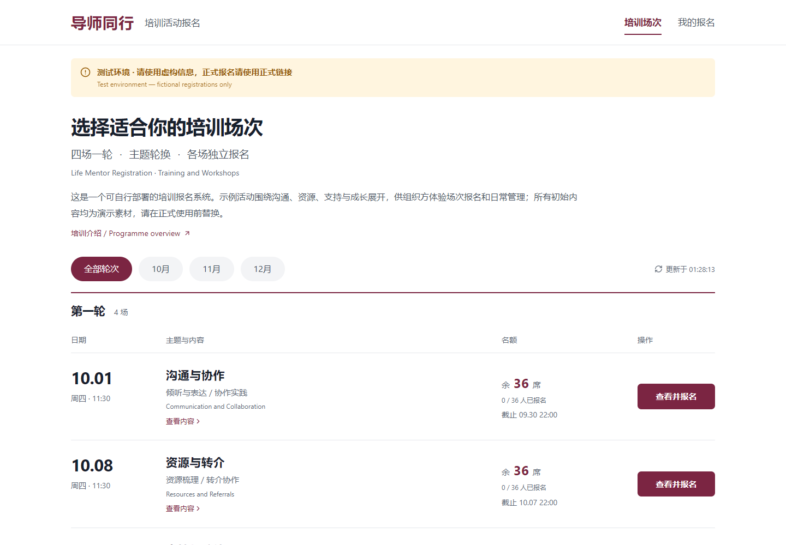
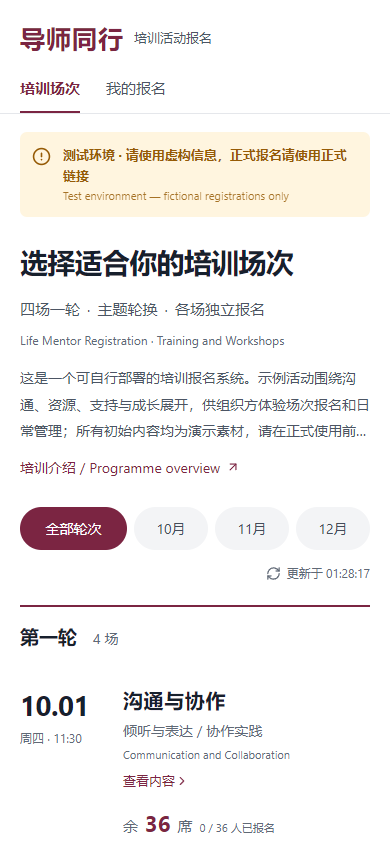
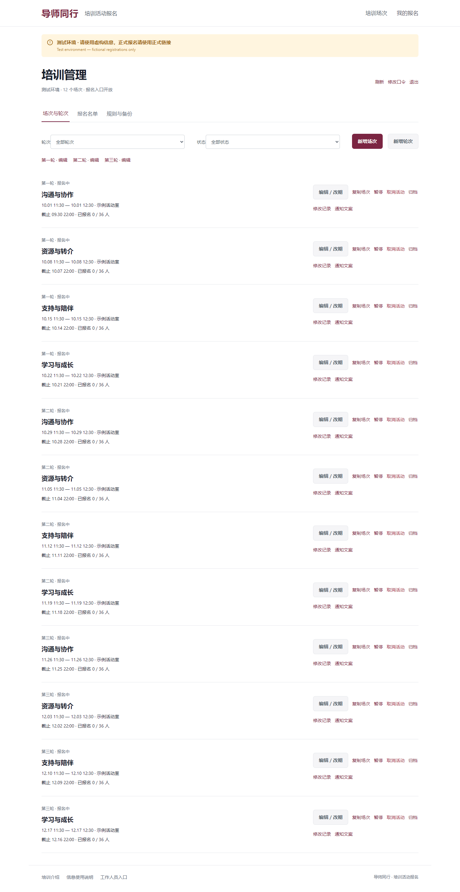

# Life Mentor Registration · 导师同行

[](https://github.com/Lurek-st/life-mentor-registration/actions/workflows/ci.yml)
[](LICENSE)

面向小规模机构内部培训的报名系统：参加者填写**姓名、部门、工号**即可报名；工作人员管理每场的时间、名额、状态和名单。支持 Cloudflare Pages + D1，也可完全在本机体验。

A self-hostable, Chinese-first training registration app with per-session capacity and deadlines, account-free participant registration, private booking receipts, and a staff console. Built with React, TypeScript, Cloudflare Workers and D1. The sample programme is fictional; no institutional endorsement is implied.



## 功能

| 参加者                                 | 工作人员                           |
| -------------------------------------- | ---------------------------------- |
| 按轮次或月份查看主题、内容、时间、地点 | 新建、复制场次，调整轮次和排序     |
| 查看已报名人数与剩余名额               | 修改容量，默认 36，可调大或调小    |
| 每场独立截止，报满或截止后停止接收     | 改期、暂停、取消、归档与恢复       |
| 三项信息报名，无需创建账号             | 姓名、部门、工号纠错和名单筛选     |
| 私密凭证查看“我的报名”、自行取消       | XLSX 名单导出、JSON 备份和修改记录 |
| 提交结果丢失后的恢复、重复提交保护     | 显示变更影响人数，检查并发修改冲突 |

名额和截止规则由后端及数据库执行。降低容量不会挤掉已有报名；改期不改变所属轮次；取消活动保留名单；恢复活动不会恢复个人已取消的报名。人数通过重新获取服务器数据更新，**不是 WebSocket 实时推送**，提交时以数据库为准。

<details>
<summary>查看手机端和工作人员后台</summary>





</details>

## 本机快速开始

需要 **Node.js 24.x**、npm、Git。无需云账户、域名或真实资料。示例日期在初始化时生成，首场至少在一周以后。

```sh
git clone https://github.com/Lurek-st/life-mentor-registration.git
cd life-mentor-registration
npm ci
npm run setup
npm run db:local
npm run build
npm run preview
```

打开 <http://127.0.0.1:8787>。演示报名的工号须以 `TEST-` 开头，例如 `TEST-0000123`，姓名和部门也请填写虚构信息。

**后台登录：**打开 <http://127.0.0.1:8787/#staff>，在本机 `.dev.vars` 文件中查看自动生成的 `ADMIN_PASSWORD`。没有默认的通用密码。该文件已忽略，不要提交或截图分享。后台修改口令后，以新口令为准；更换口令会注销现有工作人员会话。

`npm run db:local` **仅对空库执行一次**。重复初始化会被拒绝，不会清空已有数据。以后启动只需 `npm run preview`。本机数据位于忽略的 `.wrangler/` 中。

## 测试

```sh
npx playwright install chromium
npm run build
npm test
```

测试使用独立的本机数据库和随机数据空间，默认端口 `8788`；不会访问云端数据库。覆盖桌面与手机界面、断网恢复、最后一个名额的竞争、500 次集中提交、重复报名、旧页面、容量下调、改期、取消与恢复、后台会话、导出和备份恢复。500 次提交是本机正确性测试，**不是云端吞吐量或服务可用性保证**。

Linux 如缺少浏览器依赖，使用 `npx playwright install --with-deps chromium`。已有 Chrome 的 Windows 开发者也可先设置环境变量 `PW_CHANNEL=chrome`。测试会生成私有工作文件到 `work/`，不要公开整个目录或测试数据库。

GitHub Actions 会执行类型检查、构建、内容检查和完整本机测试。流程没有云部署凭据，也不会自动发布网站。

## 部署与定制

- [部署到自己的 Cloudflare 账户](docs/DEPLOYMENT.md)：演示与正式库分开、环境变量、HTTPS 和上线检查。
- [使用与运维](docs/OPERATIONS.md)：工作人员入口、口令、名单、通知、备份和恢复。
- [架构与规则](docs/ARCHITECTURE.md)：数据模型、并发、信任边界、扩展位置。
- [参与贡献](CONTRIBUTING.md) · [安全报告](SECURITY.md) · [更新记录](CHANGELOG.md)

通用主题模板在 `shared/programme.ts`，议程模板在 `shared/model.ts`，名称和介绍展示在 `src/App.tsx` 与 `index.html`。示例排期由 `scripts/seed-demo.mjs` 生成；部署后通过后台维护实际场次。日期显示和“前一晚 22:00”采用北京时间 `Asia/Shanghai`。

## 适用范围

这是适合**可信内部群体**的轻量工具。工号用于去重，不验证真实身份；工作人员共享管理口令，没有个人角色权限、SSO 或实名审计。报名凭证是查看和取消个人报名的授权依据，丢失后由工作人员协助，不能只凭姓名或工号公开找回。

没有自动短信、邮件、微信通知、候补队列、支付或自动数据清理功能。改期通知和数据保留、删除由组织方落实。完整备份包含个人资料和审计记录，应私下保管。准备面对公开互联网或更高要求的组织使用时，应先补充身份认证、角色权限和相应运维机制。

软件按 MIT 许可免费使用。托管服务的可用地区、费用、免费额度与账号计划由服务商和部署者决定；本仓库不保证永久免费，也不代表已完成第三方安全审计。

## 许可证

[MIT](LICENSE) © 2026 Chengyang Lu (Lurek Lu)。可复用、修改和再分发，保留许可证与版权声明。第三方依赖保留各自许可证，见 [THIRD_PARTY_NOTICES.md](THIRD_PARTY_NOTICES.md)。本仓库仅包含通用源码、虚构示例和文档，不包含任何机构内部材料、生产配置或报名数据。
