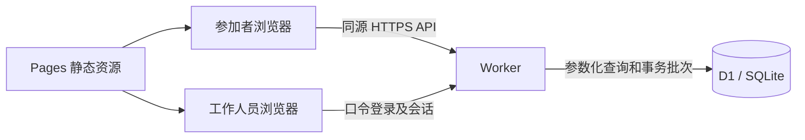

# 架构与规则

React + TypeScript 负责页面，Vite 构建客户端；esbuild 把 `worker/index.ts` 编译成 Pages Advanced Mode 的 `_worker.js`。本机使用 Wrangler 的 Workers 运行时和本地 D1，不依赖远程数据库。数据库结构版本为 2。

## 代码位置

| 路径                                                              | 职责                             |
| ----------------------------------------------------------------- | -------------------------------- |
| `src/App.tsx`, `src/SessionDrawer.tsx`, `src/MyRegistrations.tsx` | 列表、报名、“我的报名”           |
| `src/Admin.tsx`                                                   | 工作人员界面                     |
| `worker/index.ts`                                                 | 公共接口、个人凭证、登录         |
| `worker/admin.ts`                                                 | 后台写入、名单、备份和审计       |
| `worker/core.ts`                                                  | 校验、哈希、会话、查询和响应     |
| `shared/model.ts`, `shared/programme.ts`                          | 类型、时间函数、通用内容模板     |
| `schema/v2.sql`                                                   | 表、索引和约束触发器             |
| `scripts/`                                                        | 构建、样例初始化、测试、恢复校验 |

## 数据与一致性

`rounds` 保存轮次，`sessions` 保存具体场次和容量，`registrations` 保存个人信息与取消状态，`settings` 保存规则。`audit` 记录修改；`admin_sessions` 保存已哈希的登录令牌；`rate_limits` 保存短期限制状态。

报名使用客户端生成的请求 ID 和私密凭证。请求发出前浏览器持久化恢复材料；响应丢失后仍能恢复同一笔报名。服务端核对请求指纹，相同请求幂等返回，修改请求内容不能复用原 ID。只有持有对应凭证才能查询、取消或确认变更。

数据库在插入报名时检查报名开关、场次状态、截止、内容版本、容量和个人场数限制。有效报名的“场次 + 工号哈希”有唯一约束；数据库触发器维护计数。界面显示过时不影响最终约束。名额竞争测试会验证最后一个位置仅一人成功。

后台写入同时检查记录版本及预计影响人数，避免工作人员在旧数据上静默覆盖。容量变化与内容变化分别处理：重要内容更新增加内容版本并要求参加者确认；容量下调不删除报名。

## 信任边界

- 公共接口只提供活动信息与汇总人数；个人报名接口需要随机凭证，后台接口需要有效会话。
- 工号是用户声明，未做学校身份验证。适合可信内部用户，不防止有人冒用他人工号或恶意占位。
- 工作人员具有完整管理权限。共享口令会话使用 HttpOnly Cookie，在 HTTPS 下启用 Secure，并设置 SameSite=Strict；写接口检查已提供的 Origin。
- SQLite/D1 中业务个人资料并非应用层加密，数据库管理者可读。工号哈希用于查询/去重，不代表原工号匿名化。
- 凭证在浏览器中是持有即授权的资料，跨设备需导入。公用设备应清除保存凭证。
- 请求限流只用于基础保护，不是完善的防机器人或抗 DDoS 方案。没有 SSO、MFA、角色分工或逐人工作人员审计。

## 时间与规模

数据库保存 Unix 秒，显示按 `Asia/Shanghai`；默认截止为活动前一天 22:00，后台可单独调整。12 场、每轮 4 场属于示例种子；数据模型没有固定总场数或周几的限制。当前首页说明按示例组织方式编写，采用其他形式时应同步调整说明。

测试包括 100 个请求争抢最后名额和 500 次集中提交；它们验证本机约束与应用行为。长期运行容量仍取决于平台限制、索引、数据增长和真实网络；没有云端性能服务承诺。

## 扩展与验证

优先通过后台调整运营数据。改变报名状态机、数据库结构、凭证格式或哈希规范时，需要迁移方案、旧数据兼容和新的行为测试。不要用修改种子文件来迁移已有数据库。

仓库的 CI 使用虚构信息，所有变更性测试检查 loopback 地址和随机测试数据空间。未来贡献不得解除该限制来“顺便测一下”生产站点。公开内容检查仅覆盖明确的误上传类型和部分凭据特征，不代替人工审查或独立安全评估。
